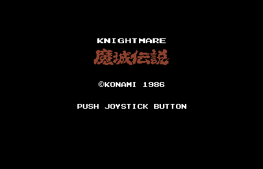
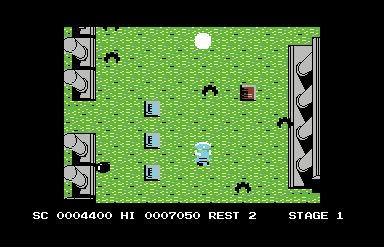
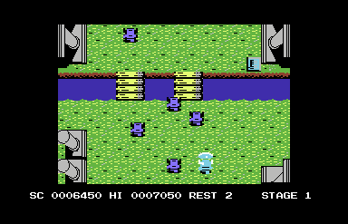
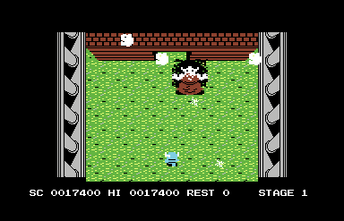

# KNIGHTMARE — Commodore 64

*A Fan Project — Fausto Macedo (2026)*

**English** | [Português (Brasil)](README.pt-BR.md)

Knightmare, released by Konami in 1986 for the MSX, holds a very special place in my heart. It was the first game I ever played on an MSX during my childhood, and it remains one of the platform's most iconic titles.

Decades later, as a collector and retrocomputing enthusiast, I had the opportunity to become more familiar with the Commodore 64. That's when an idea came to mind: why not bring Knightmare to this machine as well? I thought it would be interesting to see one of my favorite games make its way to another classic 8-bit computer, while preserving as much of the original MSX experience as possible.

In 2026, as Knightmare celebrates its 40th anniversary, that idea has become a Commodore 64 adaptation.

Development began with an initial Commodore 64 adaptation created with the assistance of Claude, an AI developed by Anthropic, using resources from the Knightmare recreation written in MMBasic by Leonardo Nicolas for the Colour Maximite 2 as a starting point.

The project then went through an extensive process of development and refinement with the help of ChatGPT, developed by OpenAI. Using the original MSX ROM and its Z80 disassembly as the primary references, countless corrections, reimplementations, graphical improvements, music and sound effect adaptations, as well as extensive testing and comparisons with the original game, were carried out. The goal has always been to achieve the highest possible level of fidelity while respecting the capabilities and limitations of the Commodore 64 hardware.

The result of this effort is the first public release of Knightmare for the Commodore 64 NTSC. The first stage is fully completed and playable, while the remaining stages are still under development.

The project continues to evolve. My intention is to gradually implement the remaining stages until Knightmare can be played from beginning to end on the Commodore 64, staying as faithful as possible to the original experience.

This is a personal, non-commercial fan project, created out of admiration for Konami's original work and the simple pleasure of bringing one of the MSX's greatest classics to another 8-bit platform.

I hope you enjoy playing this adaptation as much as I enjoyed — and challenged myself — developing it!

Fausto Macedo

## Compatibility

Developed for the Commodore 64 NTSC, with testing performed using the VICE emulator and original Commodore 64 hardware.

Compatibility with PAL systems has not yet been verified.

## Credits and Acknowledgments

- **Konami** — Creator of the original Knightmare for MSX (1986).

- **Leonardo Nicolas** — MMBasic recreation whose resources served as the starting point for this adaptation.

- **Claude (Anthropic)** — Initial Commodore 64 adaptation.

- **ChatGPT (OpenAI)** — Development, refinements, bug fixes, and feature implementation.

- **Fausto Macedo** — Project concept, coordination, testing, validation, and development direction.

Independent, unofficial, non-commercial fan project.

## Screenshots

### Title Screen

### Gameplay

### River Bridge

### Stage 1 Boss

MMBasic recreation for the Colour Maximite 2:
[https://github.com/leonicolas/knightmare-cmm2](https://github.com/leonicolas/knightmare-cmm2)
